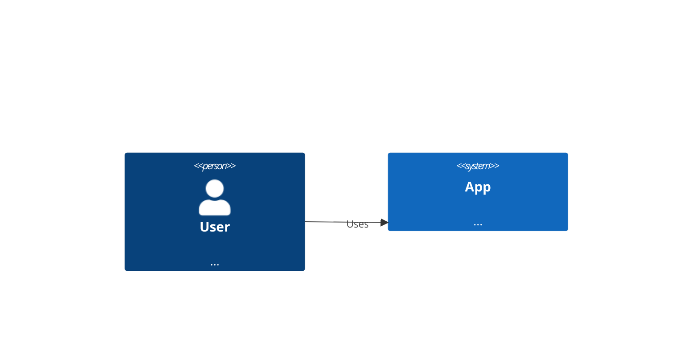

# C4 Architecture (`c4`)

WebGME project housing a DSML metamodel for Mermaid **C4 Architecture**.

## Mermaid keywords

- `C4Context`
- `C4Container`
- `C4Component`
- `C4Dynamic`
- `C4Deployment`

## Status

`stable`

## Domains

- software-architecture
- system-context
- enterprise-architecture

## Capabilities

- C4 levels: Context, Container, Component, Dynamic, Deployment
- Persons, systems, containers, DBs, queues, boundaries
- Typed relations with technology labels

## Syntax highlights



## Layout

| Path | Purpose |
|------|---------|
| `metamodel/Language.json` | webgme-json metamodel draft |
| `examples/sample.mmd` | Canonical Mermaid sample |
| `src/plugins/ImportMermaid` | Mermaid text → model |
| `src/plugins/ExportMermaid` | model → Mermaid text |
| `src/plugins/ApplyLanguageMeta` | Apply Language.json via Core |

## Run (requires MongoDB)

```bash
npm install
# from repo root or this package after workspace install
npm start
```

Then open the configured WebGME port, create a project from this seed/language, run **ApplyLanguageMeta**, then **ImportMermaid**.
