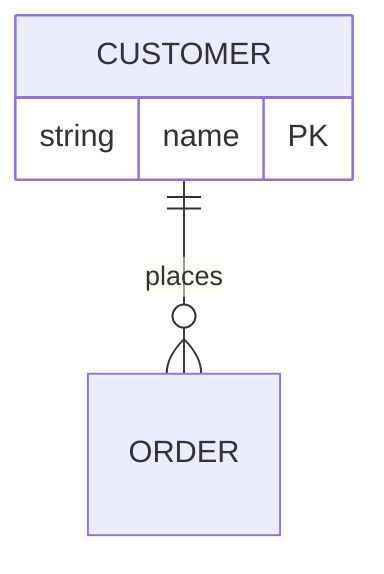

# Entity Relationship Diagram (`er`)

WebGME project housing a DSML metamodel for Mermaid **Entity Relationship Diagram**.

## Mermaid keywords

- `erDiagram`

## Status

`stable`

## Domains

- database-design
- data-modeling
- information-architecture

## Capabilities

- Entities with typed attributes and keys
- Cardinality relationships (one/zero/many)
- Identifying vs non-identifying relationships
- Attribute keys PK/FK/UK

## Syntax highlights



## Layout

| Path | Purpose |
|------|---------|
| `metamodel/Language.json` | webgme-json metamodel draft |
| `examples/sample.mmd` | Canonical Mermaid sample |
| `src/plugins/ImportMermaid` | Mermaid text → model |
| `src/plugins/ExportMermaid` | model → Mermaid text |
| `src/plugins/ApplyLanguageMeta` | Apply Language.json via Core |

## Run (requires MongoDB)

```bash
npm install
# from repo root or this package after workspace install
npm start
```

Then open the configured WebGME port, create a project from this seed/language, run **ApplyLanguageMeta**, then **ImportMermaid**.
