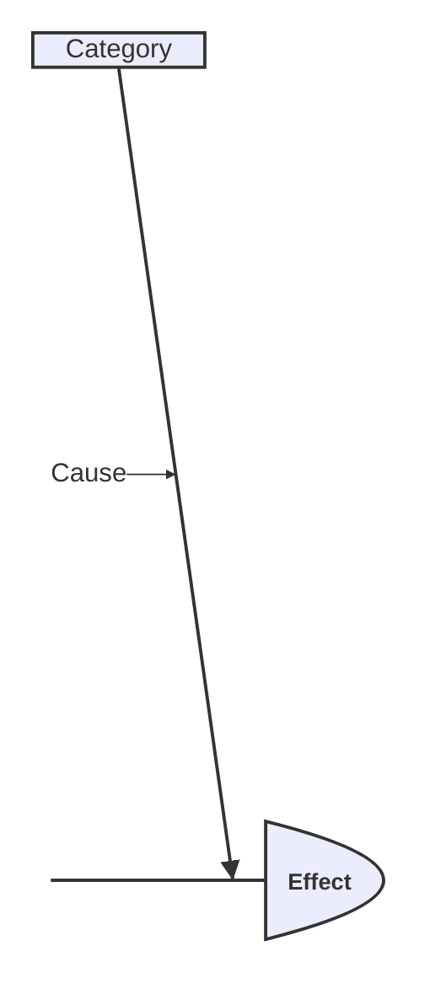

# Ishikawa (Fishbone) (`ishikawa`)

WebGME project housing a DSML metamodel for Mermaid **Ishikawa (Fishbone)**.

## Mermaid keywords

- `ishikawa`
- `ishikawa-beta`
- `fishbone`

## Status

`stable`

## Domains

- quality-management
- root-cause-analysis
- manufacturing
- continuous-improvement

## Capabilities

- Effect spine with cause categories
- Nested causes

## Syntax highlights



## Layout

| Path | Purpose |
|------|---------|
| `metamodel/Language.json` | webgme-json metamodel draft |
| `examples/sample.mmd` | Canonical Mermaid sample |
| `src/plugins/ImportMermaid` | Mermaid text → model |
| `src/plugins/ExportMermaid` | model → Mermaid text |
| `src/plugins/ApplyLanguageMeta` | Apply Language.json via Core |

## Run (requires MongoDB)

```bash
npm install
# from repo root or this package after workspace install
npm start
```

Then open the configured WebGME port, create a project from this seed/language, run **ApplyLanguageMeta**, then **ImportMermaid**.
