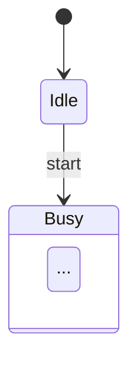

# State Diagram (`state`)

WebGME project housing a DSML metamodel for Mermaid **State Diagram**.

## Mermaid keywords

- `stateDiagram`
- `stateDiagram-v2`

## Status

`stable`

## Domains

- finite-state-machines
- embedded-systems
- ui-state
- protocol-state
- uml

## Capabilities

- States, transitions with events/guards/actions
- Composite (nested) states
- Choice, fork/join, history (shallow/deep)
- Notes, concurrency (--)

## Syntax highlights



## Layout

| Path | Purpose |
|------|---------|
| `metamodel/Language.json` | webgme-json metamodel draft |
| `examples/sample.mmd` | Canonical Mermaid sample |
| `src/plugins/ImportMermaid` | Mermaid text → model |
| `src/plugins/ExportMermaid` | model → Mermaid text |
| `src/plugins/ApplyLanguageMeta` | Apply Language.json via Core |

## Run (requires MongoDB)

```bash
npm install
# from repo root or this package after workspace install
npm start
```

Then open the configured WebGME port, create a project from this seed/language, run **ApplyLanguageMeta**, then **ImportMermaid**.
